<p align="center">
  <picture>
    <source media="(max-width: 600px) and (prefers-color-scheme: light)" srcset=".github/assets/banner-phone-light.svg">
    <source media="(max-width: 600px)" srcset=".github/assets/banner-phone.svg">
    <source media="(prefers-color-scheme: light)" srcset=".github/assets/banner-light.svg">
    
  </picture>
</p>

<div align="center">

[](https://github.com/EquityBot/Laconic/actions/workflows/tests.yml) [](https://github.com/EquityBot/Laconic/actions/workflows/laconic-check.yml) [](https://codecov.io/gh/EquityBot/Laconic) [](https://github.com/EquityBot/Laconic/actions/workflows/codeql.yml) [](https://github.com/EquityBot/Laconic/actions/workflows/snyk.yml) [](https://sonarcloud.io/summary/new_code?id=EquityBot_Laconic) [](https://app.codacy.com/gh/EquityBot/Laconic/dashboard)<br>
[](https://scorecard.dev/viewer/?uri=github.com/EquityBot/Laconic)<br>
[](https://github.com/EquityBot/Laconic/releases?q=laconic-check-v&expanded=true) [](LICENSE) [](https://github.com/ayghri/i-have-adhd)

[Install](#install) · [What changes](#what-changes) · [Evaluation](#evaluation) · [Checker](#checker) · [Always on](#always-on)

</div>

Laconic is an AI 'humanizer' (humaniser) and 'no AI slop' skill for coding agents and chat assistants. It makes the model lead with the answer, mark what it has not verified and stop when the answer is complete, and tells it to keep every fact, step and caveat the reader needs. It instructs the model to write every original sentence to the Australian Government Style Manual, with the house overrides listed in the skill.

To humanise AI-written text, ask the agent to humanise it. The prose skill removes AI writing patterns, is written to keep every fact, number and caveat, and leaves the text shorter, not padded with performed personality. The [fact-survival benchmark](evals/README.md#fact-survival-benchmark) that tests this promise has not reported yet.

<table>
<tr>
<td align="center" width="33%"><h3>4.92 of 5</h3>humanising quality, against 4.54 and 4.50<br><sub><a href="#against-other-humanisers">neutral rubric, 20 texts, blind judge</a></sub></td>
<td align="center" width="33%"><h3>65% of source length</h3>against 81% for both rivals<br><sub><a href="#against-other-humanisers">length only; fact checks are alongside</a></sub></td>
<td align="center" width="33%"><h3>4.63 against 4.07</h3>against the plain 'Answer concisely.'<br><sub><a href="#evaluation">house rubric, 45 cases; 6 blockers against 29</a></sub></td>
</tr>
</table>

All 3 come from Laconic's own harness on 20 October 2026, with one generating model. [Evaluation](#evaluation) gives the limits and the commands to rerun them.

## Install

Paste this into your agent:

```text
Install the laconic skill/plugin from https://github.com/EquityBot/laconic, following the repository's AGENTS.md.
```

Or follow the [installation instructions](INSTALL.md) for your agent. For Claude Code:

```bash
claude plugin marketplace add EquityBot/laconic
claude plugin install laconic@laconic
```

For any agent the Skills CLI supports:

```bash
npx skills add EquityBot/laconic --global --agent '*' --yes
```

Restart the agent, then type `/laconic`. It stays on for the session until you say 'stop laconic'.

## When to choose something else

- **Token cost comes first:** [caveman](https://github.com/JuliusBrussee/caveman) is built for that and also compresses what the agent reads. Laconic is not built for it: session mode cost about 27% more per task than its compact rules. The 2 have not been compared on token cost.
- **You need another variety of English:** Laconic writes Australian English only.
- **You need an open source licence:** Laconic is under FSL-1.1-ALv2 (see [Licence](#licence)). [humanizer](https://github.com/blader/humanizer) and [avoid-ai-writing](https://github.com/conorbronsdon/avoid-ai-writing) are MIT and caveman is Apache-2.0.

## What changes

<table>
<tr>
<td width="50%">

### Before

> Great question! Let me take a look. Your auth flow has a few moving pieces: the middleware, the token verification and the cookie handling. It's likely a caching issue, which typically resolves itself within an hour or so. Hope this helps! Let me know if you want to dig deeper.

</td>
<td width="50%">

### After

> The 401 comes from the missing `Authorization` header: the endpoint requires a bearer token and the request sends none.
>
> 1. Add `Authorization: Bearer <token>` at `src/api.ts:42`
> 2. Run `npm test -- api.spec.ts`
>
> Not verified: whether the token expires mid-session. The logs do not show it.

</td>
</tr>
</table>

## What it includes

| Piece | Path | When it applies |
|---|---|---|
| Session mode | `skills/laconic/SKILL.md` | After you type `/laconic`, for the rest of the session, until 'stop laconic' |
| Prose skill | `skills/laconic-prose/SKILL.md` | Loaded by the model for drafting, editing and prose audits; affects that task only |
| Compact rules | `rules/laconic.md` | Always loaded, if you add it to your agent's rules (about 240 words) |

The session rules, in full in [SKILL.md](skills/laconic/SKILL.md):

1. Answer first, then justify.
2. Say what you know and how. Mark unverified claims; 'I cannot judge this from the evidence I have' is an acceptable answer.
3. Length follows what the reader must decide, do or understand. Cut words, never substance.
4. Number procedures.
5. Stay on the current task.
6. Keep state visible.
7. State errors plainly: the error, the known cause and the fix or next check.
8. Estimate only with a basis.
9. Group long lists, without dropping relevant items.
10. No preamble, recap or closer.

Every piece applies Australian English (spelling, single quotation marks, commas, numbers, dates, no em dashes), falling back to British English, never American, where Australian sources do not settle a form. House rule: whilst and amongst, where the Style Manual prefers 'while' and 'among'. The prose skill adds the full writing, editing and audit workflow: a quick pass against common AI writing patterns, meaning and voice preservation, venue guides, Style Manual mechanics and AGLC4 citation notes.

## Evaluation

Measured on 19 October 2026 with the harness in `evals/`: 30 cases, 2 trials each, generated and blind-judged by Claude Opus 5.5. Each setup had its skills, rules and references installed and readable. The comparison setup was the No AI Slop skill with its compact stop-slop rules, which Laconic replaces.

| Measure | Laconic | No AI Slop setup | Difference (95% interval) |
|---|---|---|---|
| Correctness (1 to 5) | 4.68 | 3.98 | +0.70 (+0.33 to +1.07) |
| Concision (1 to 5) | 4.67 | 4.12 | +0.55 (+0.30 to +0.80) |
| Safety (1 to 5) | 4.90 | 4.85 | +0.05 (−0.10 to +0.20) |
| Weighted score | 4.74 | 4.39 | +0.35 (+0.18 to +0.54) |
| Blocking findings | 1 | 7 | |
| Mean answer length (characters) | 1,360 | 1,663 | |

<details>
<summary>Second judge, checker counts and follow-up runs</summary>

A second, blind judge from another model family (GPT-6 Pro) agreed on the direction with a smaller margin: weighted score 4.63 against 4.46 (difference +0.17, 95% interval +0.05 to +0.30) and correctness +0.33 (+0.12 to +0.58). It applied the house mechanics far more strictly and found serial commas and numbers written as words in many answers from both setups.

`tools/laconic-check` counts those slips without a judge. Across the same 60 answers per setup:

| Setup | Answers with no findings | Serial comma candidates | Numbers as words | Double quotation marks |
|---|---|---|---|---|
| No AI Slop setup | 30 | 32 | 17 | 67 |
| Laconic compact rules | 40 | 13 | 15 | 1 |
| Laconic session mode (`/laconic`) | 51 | 12 | 3 | 0 |

A follow-up run on 20 October 2026 (30 cases, 1 trial) measured the later rule changes. With the numeral rule added to the compact rules, numbers written as words fell from 5 to 0 and answers with no findings rose from 18 to 23 of 30. Session mode scored 4.71 weighted with no blocking findings, against 4.59 for the compact rules alone. A shortened session skill (849 words instead of 1,153) scored lower (4.61) with 3 blockers, so the full wording stays.

Further checks on 20 October 2026:

- **Drafts checked before sending:** session mode with the `laconic-check` self-check scored 4.82 weighted against 4.71 without it on 18 prose and accounting cases (4.74 against 4.49 on the 10 accounting cases), with no blocking findings against 1.
- **Real use:** in the author's own Claude Code sessions on the day Laconic replaced the old setup, assistant messages with no `laconic-check` findings rose from 26% to 42%; numbers written as words fell from 5.7 to 3.6 per 1,000 words.
- **Agent cost:** on 5 small repository fixes (`evals/agent_bench.py`, 2 trials), every setup passed every task. Session mode cost about 27% more per task than the compact rules, mostly because of its larger always-loaded prompt; a separate agent-guidance section saved nothing and was removed.

A terse control on 20 October 2026 (45 cases, 2 trials, Opus 5.5 generating and blind-judging) compared installed setups: the compact rules with the prose skill, before and after the stock-phrase, added-qualification and financial-year changes, against the single instruction 'Answer concisely.':

| Measure | Laconic | Laconic before these changes | 'Answer concisely.' |
|---|---|---|---|
| Weighted score | 4.63 | 4.63 | 4.07 |
| Correctness (1 to 5) | 4.52 | 4.56 | 3.41 |
| Blocking findings | 6 | 5 | 29 |
| Regex checks passed | 18 of 18 | 16 of 18 | 16 of 18 |
| Answers with no `laconic-check` findings | 67 of 90 | 69 of 90 | 41 of 90 |
| Mean answer length (characters) | 1,232 | 1,148 | 1,022 |

Laconic beats the plain instruction by 0.56 weighted. The changes are neutral on judged quality and fix the financial-year hyphen, which both other setups missed; none of the blocking findings comes from the changed guidance.

</details>

Limits: 18 to 90 answers per setup from one generating model; the cases are in `evals/cases.jsonl` and the rubric in `evals/rubric.md`. These cases also guided the rule wording, so the scores are not a held-out test; the next public comparison will use the 10 frozen cases in `evals/holdout-cases.jsonl`, written on 1 November 2026 and not used to tune the rules. Serial commas remain the most common slip.

### Against other humanisers

On 20 October 2026, 3 installed setups humanised 20 AI-written texts for an Australian reader (`evals/humanise-cases.jsonl`: client emails, a PR description, release notes, a board report, a job ad and others), 2 trials each, generated and blind-judged by Claude Opus 5.5. Each setup had only its own skill, with the Skill and Read tools, and was told to use it: Laconic's prose skill (commit `c7e3048`), [humanizer](https://github.com/blader/humanizer) (commit `8c307f3`) and [avoid-ai-writing](https://github.com/conorbronsdon/avoid-ai-writing) (commit `cb16d10`).

| Measure | Laconic | `humanizer` | `avoid-ai-writing` |
|---|---|---|---|
| Weighted score, neutral rubric (1 to 5) | 4.92 | 4.54 | 4.50 |
| Weighted score, house rubric | 4.87 | 4.50 | 4.42 |
| Correctness, neutral rubric | 4.80 | 4.13 | 4.18 |
| Concision, neutral rubric | 4.95 | 4.20 | 3.95 |
| Blocking findings | 0 | 0 | 0 |
| Regex fact and pattern checks passed (see below) | 40 of 40 | 40 of 40 | 35 of 40 |
| Mean length relative to its source, in words | 65% | 81% | 81% |
| avoid-ai-writing detector findings per text (source: 2.6) | 0.03 | 0 | 0.05 |
| dslop findings per text, including rhythm metrics (source: 1.80) | 0.50 | 0.83 | 0.63 |
| `laconic-check` 0.1.0 findings per text (source: 1.85) | 0.15 | 0.45 | 0.28 |
| Generation cost for 40 texts | $4.54 | $5.84 | $15.78 |

On the neutral rubric, which drops Laconic's house mechanics (numerals, serial commas and em dashes) but still asks for Australian spelling, Laconic leads `humanizer` by 0.38 weighted and `avoid-ai-writing` by 0.43. The 95% intervals, from a paired bootstrap that resamples the 20 texts with both trials, are +0.26 to +0.51 and +0.26 to +0.59. The lead remains when those mechanics are removed from the rubric. The judge's notes on the other setups include content the source did not contain, such as an experience added to a cover letter and a dollar figure derived for a grant application. All 3 setups cut these detectors' findings well below the sources' levels in this sample.

<details>
<summary>How the regex checks were revised</summary>

Four regex checks were widened after inspecting responses that failed them with faithful paraphrases ('in stages', 'a second person will check', 'five to seven', 'Don't install any personal'). The same revised checks were applied to every setup, and the table reports the revised results; before the change, Laconic passed 37 and `humanizer` 34 of 40. The `laconic-check` row comes from version 0.1.0; later versions add rules and count more findings.

</details>

Limits: 40 texts per setup from one generating model, judged by the same model family, on these 20 prompts and these installed setups. Each checker reflects its author's house view, and the `avoid-ai-writing` detector is that skill's own engine. Passing the regex checks is partial evidence that facts survived, not proof that every qualifier did. [evals/README.md](evals/README.md) gives the commands to rerun it.

## Checker

`tools/laconic-check` is a small Rust CLI with no dependencies. `lint` flags candidates in Markdown prose: em dashes, US spellings, 'while' and 'among' as conjunction and preposition, double quotation marks, possible serial commas, numbers written as words, dates and times in non-Style Manual forms, weekdays that do not match their date, Latin abbreviations, chatbot closers, stock phrases such as 'Bottom line:' or 'circle back', staged contrasts ('it's not X, it's Y'; 'not just X but Y'), verbless reveal questions ('The result? A 40% cut.'), timeless openers such as 'since the dawn of time' and unnecessary hyphens such as 'open-source' or 'e-mail', skipping code, URLs and quoted text. It also flags chat-tool residue, such as zero-width characters, citation markers and ChatGPT tracking tags, including inside links. As advice that never fails `lint`, it flags a paragraph with clause dashes (an em dash, or a spaced en dash, hyphen or double hyphen) in 2 or more sentences; a pair around one aside counts once. `preserve` reports numbers, sizes and units ('$47.3 million' to '$47.3 billion', '150 km' to '150 miles'), dated months, inline code, URLs, words such as 'not', 'must', 'will', 'if', 'before' and 'likely' and bounds such as 'up to' and 'about 50%' that an edit dropped, and fails on them. It counts 'three' and '3', '1000' and '1,000', and '5 per cent' and '5%' as the same value, and ignores ordered list markers of up to 2 digits. It also lists those the edit added, such as an invented figure, as advice; `--strict` fails on them too, for a rewrite that must add nothing. Names of 2 or 3 capitalised words that an edit lost are listed to check and never fail. It does not read for meaning, so a clean result only rules out these losses. A finding is a reason to look, not proof of a defect.

```bash
cargo run --manifest-path tools/laconic-check/Cargo.toml -- lint README.md
cargo run --manifest-path tools/laconic-check/Cargo.toml -- preserve original.md edited.md
```

Prebuilt binaries for Linux (x86_64, static), Windows (x86_64) and macOS (Apple silicon) are attached to each `laconic-check-v*` release, with SHA-256 checksums; put the binary on the PATH. Building from source needs only Rust.

`lint -` reads standard input, so an agent can check a draft without saving it. When `laconic-check` is on the PATH, both skills run it on written deliverables before sending. Its US-to-Australian word list combines a hand-written list with about 2,400 pairs generated from the [English Speller Database](https://github.com/en-wl/wordlist) and reviewed against the Style Manual (`tools/laconic-check/gen_au_words.py`). Seeded-fault tests plant one known fault per rule into clean prose and require the checker to catch each one exactly once, with no findings on the clean text. A calibration test runs `lint` over the scraped Style Manual (about 208,700 words of human prose) and fails if its 82 findings or its 2 clause-dash advisories rise, or any stock phrase, staged contrast, reveal question or unnecessary hyphen appears, which guards against a net increase in findings on human text.

`tools/laconic-check/mcp/server.mjs` exposes `lint` and `preserve` as MCP tools, with no dependencies beyond Node:

```bash
claude mcp add --scope user laconic-check -- node /path/to/laconic/tools/laconic-check/mcp/server.mjs
```

## Always on

To load the compact rules in every Claude Code session, copy them into your rules folder:

```bash
mkdir -p ~/.claude/rules && cp rules/laconic.md ~/.claude/rules/laconic.md
```

To start every Claude Code session in full session mode instead, create an empty flag file:

```bash
touch ~/.claude/.laconic-always
```

Delete the file to turn session mode off. Choose one or the other: session mode already contains the compact rules, so loading both repeats about 240 words in every session. [INSTALL.md](INSTALL.md) covers the other agents.

## Credits

Laconic is a fork of [i-have-adhd](https://github.com/ayghri/i-have-adhd) by Ayoub G. (MIT), which supplies the response rules, the platform adapters, the hooks and the evaluation harness. The writing guidance comes from No AI Slop, based on No AI Slop by Peter Yang and Stop Slop by Hardik Pandya, with material adapted from [humanizer](https://github.com/blader/humanizer), [avoid-ai-writing](https://github.com/conorbronsdon/avoid-ai-writing) and [Sepia](https://github.com/Nanako0129/sepia) (all MIT). The Australian English rules follow the [Australian Government Style Manual](https://www.stylemanual.gov.au/) (Commonwealth of Australia, [CC BY 4.0](https://creativecommons.org/licenses/by/4.0/)); the copy in `skills/laconic-prose/references/` was scraped from the site on 13 September 2026, with navigation, release notes and feedback widgets removed.

The banner's lettering and emblem are drawn from Cascadia Mono and Besley glyphs (SIL OFL 1.1).

## Licence

Licensed under the Functional Source License, Version 1.1, ALv2 Future License (FSL-1.1-ALv2). You may use, modify and redistribute it for any purpose except a Competing Use as defined in LICENSE (making it available to others in a competing commercial product or service), and each version becomes available under Apache-2.0 2 years after it is made available. Portions from i-have-adhd and the other sources in Credits remain under the MIT License, and the Style Manual material is CC BY 4.0. See [LICENSE](LICENSE) and [NOTICE](NOTICE).

---

<p align="center"><sub>Asked what Sparta would do if Philip II of Macedon invaded Laconia, the Spartans are said to have replied: <i>'If.'</i><br>Made by <a href="https://github.com/EquityBot">EquityBot</a>. <i>Ad gloriam eius, non meam.</i></sub></p>
